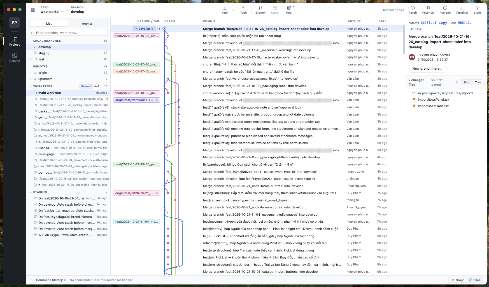
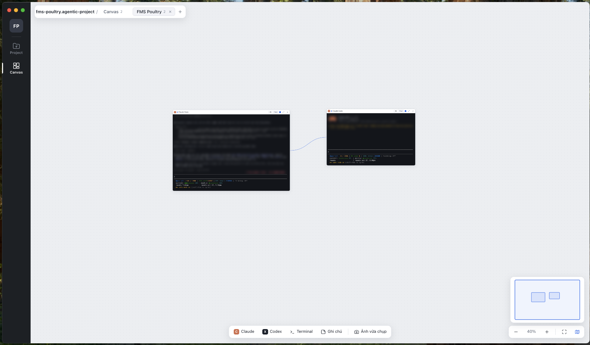

# GitMenorah

**Run a team of coding agents side by side, each on its own branch, all on one canvas.**

GitMenorah is a desktop app for developers who work with Claude Code and Codex every day. It brings three things into one window: an infinite canvas of live agent terminals, a Git client built around worktrees, and a lightweight native process manager that keeps those agents in check.

Start an agent, give it its own worktree, wire it to another agent's context, then review and merge the work from the same window.



---

## Why GitMenorah

Coding agents are fast. Juggling them is not. Five terminal tabs, three half-finished branches, one agent that quietly ate 14 GB of RAM, and no idea which session is waiting for you. GitMenorah is built for that.

| | |
|---|---|
| **See every agent at once** | Each Claude Code, Codex or shell session is a live node on a canvas. Pan, zoom and group them by task instead of hunting through tabs. |
| **One task, one worktree** | Spin up a branch in its own `.worktrees/<name>` folder in two clicks. Agents never step on each other's files, and your main checkout stays where it is. |
| **Know who needs you** | Running, waiting and finished states show on every node, in the Agents list and at the MacBook notch. A finished turn never sits unnoticed. |
| **Agents that share context** | Draw a wire between two nodes and each agent can read the other's notes, transcript or terminal with one command. |
| **Git you can trust** | Every Git action shows the exact commands before it runs. Nothing happens behind your back. |
| **Resource guard rails** | Cap CPU and RAM for everything your agents spawn, so a runaway test suite cannot freeze your machine. |

---

## Agents



- **Claude Code, Codex and plain terminals** as first-class nodes. `⌘T` for Claude Code, `⇧⌘T` for Codex, `⌥⌘T` for a shell.
- **Live status at a glance.** Each node shows whether the agent is running, waiting for input or done. The **Agents** view (`⌘3`) lists every session across your projects.
- **Notch indicator (macOS).** Running and waiting agents appear around the MacBook notch. Click one to jump straight to it.
- **Chat panel.** Read an agent's conversation as clean messages, including tool calls such as `Bash · npm test`, and reply from a normal text box.
- **Sub-agent strip.** Follow the sub-agents a session spawns, with their steps and when they finish.
- **Resume after restart.** Stopped Claude Code and Codex sessions reopen from the canvas with their history.
- **Screenshots in one drag.** Your recent screenshots sit in the toolbar. Drag one into a terminal to hand it to the agent.

### Shared context between agents

Connect two nodes with a wire and each agent gets the `menorah-context` command in its terminal:

```sh
menorah-context list                       # nodes wired to this one
menorah-context summary --node "API" -n 15 # last messages of a linked agent
menorah-context transcript --node "API"    # its full conversation
menorah-context terminal --node "Build"    # what a linked terminal printed
```

GitMenorah also installs a matching skill, so agents learn to use the command on their own. The command only listens on `127.0.0.1` and requires a per-session token.

---

## Worktrees

GitMenorah treats worktrees as the default way to work, not an advanced trick.

- **New worktree from the main worktree.** Press **+** next to *Worktrees* in the sidebar, or right-click any worktree and choose **New worktree from …**. The branch defaults to whatever the main worktree is on.
- **Consistent names.** Branches follow `feat/<yyyy-mm-dd-hh-mm>_<name>` or `hotfix/…`. Worktrees live in `.worktrees/<name>`, and that folder is kept out of Git automatically.
- **Every worktree at a glance.** The sidebar lists all worktrees with their branch and pending changes, sorted by newest or A–Z.
- **Open a terminal anywhere.** Open a shell in any worktree or folder from the bottom tray, or drop a terminal node on the canvas.
- **Commit & merge into develop.** Ship a feature branch from its worktree to `develop` in one reviewed step.
- **Clean up safely.** Removing a worktree is refused while it has uncommitted files or processes still running inside it, and you see which ignored files (`.env.local`, `dist/` …) would go with it. Shared branches such as `develop` and `main` are never deleted.

---

## Canvas

- **Infinite, zoomable workspace** with a minimap. `⌘0` fits everything on screen.
- **Multiple canvases per project.** Keep one per feature, sprint or experiment.
- **Notes** sit next to the agents they describe and can be shared with them through wires.
- **Layouts persist.** Close the app and your canvas, wires and sessions are where you left them.
- **Multiple windows.** `⌘N` opens another window, for example Git on one screen and the canvas on another.

---

## Git

- **Commit graph** with branch and tag lanes, commit details and changed files as a path list or tree.
- **Files view** with a file tree, per-file history and a built-in terminal.
- **Branches, remotes and stashes** in one sidebar, with fetch, pull, push, stash and pop.
- **Review before run.** Every action opens a dialog with the exact `git` commands and any warnings. **Command history** in the bottom tray keeps a record of what ran and what it printed.
- **Project groups.** Add every repository of a multi-repo product once, then fetch all of them in one click.
- **Gitflow guard.** In repositories that have a `develop` branch, `main`, `master`, `staging` and `prod` only take changes through pull requests, and merging `develop` into them is refused. Repositories without `develop` are left alone.

---

## Resource limits

Open **GitMenorah → Settings…** (`⌘,`) and set:

- **Max CPU (cores):** processes started from your terminals are throttled once they exceed the limit.
- **Max RAM (GB):** when the limit is hit, the process using the most memory is stopped and you get a notification.

Your shell and the agent itself are never throttled or killed, only the processes they spawn. On Windows, usage is measured but not enforced yet.

---

## Under the hood

- **Electron** shell for the window, canvas and Git UI.
- **menorah-agentd**, a small Go sidecar that runs every terminal (PTY on macOS, ConPTY on Windows), reads agent transcripts, enforces resource limits and serves `menorah-context`. It idles at about 6 MB of RAM. If it crashes, it restarts within a second and restores your limits and wiring.
- **No cloud, no account.** Everything runs locally against your own repositories and your own Claude Code / Codex installs.

---

## Get started

### Requirements

- macOS (Apple Silicon or Intel) or Windows x64
- Node.js 20+ and npm
- Go 1.22+ (to build `menorah-agentd`; no cgo needed)
- [Claude Code](https://docs.anthropic.com/en/docs/claude-code) and/or [Codex](https://github.com/openai/codex) installed for agent nodes

### Run from source

```sh
cd tools/git-desktop
npm ci
npm start        # builds bin/menorah-agentd first, then opens the app
```

`npm run agentd` rebuilds only the sidecar (macOS / Linux).

### Git page in a browser

The Git page also runs without the desktop app (no canvas, no agents):

```sh
node tools/git-server.mjs --open        # http://127.0.0.1:4990, --port=<n> to change
```

Repositories and project groups are saved in `~/.config/gitmenorah/git.json`, shared by the app and the browser page. Set `GITMENORAH_CONF=<file>` to use another file. Add `"linkNodeModules": true` there to give new worktrees symlinks to the main worktree's `node_modules`.

### Build installers

```sh
tools/build-git.sh --platform=macosx --arch=universal   # .dmg, Intel + Apple Silicon
tools/build-git.sh --platform=windows                   # .zip for Windows x64
```

Output goes to `tools/git-desktop/dist/`. Windows builds can be produced on a Mac.

---

## Keyboard shortcuts

| Action | macOS | Windows |
|---|---|---|
| Project · Git | `⌘1` | `Ctrl+1` |
| Canvas | `⌘2` | `Ctrl+2` |
| Agents | `⌘3` | `Ctrl+3` |
| New Claude Code | `⌘T` | `Ctrl+T` |
| New Codex | `⇧⌘T` | `Ctrl+Shift+T` |
| New terminal | `⌥⌘T` | `Ctrl+Alt+T` |
| Fit canvas | `⌘0` | `Ctrl+0` |
| New window | `⌘N` | `Ctrl+N` |
| Add repository | `⌘O` | `Ctrl+O` |
| Add project folder | `⇧⌘O` | `Ctrl+Shift+O` |
| Terminal tray (Git tab) | `` ⌃` `` | `` Ctrl+` `` |
| Settings | `⌘,` | `Ctrl+,` |

---

## What's new

See [changelogs.txt](tools/git-desktop/changelogs.txt).

---

## License

GitMenorah is open source under the [MIT License](LICENSE). Use it, change it and ship it, at work or in your own products.

---

Made by [InChurch.app](https://inchurch.app).
